# zmk-config

ZMK firmware for all my keyboards, built from **one shared keymap**
(`config/keymap.dtsi`). Every board gets the same 34 core keys and layers;
each board's own file only adds its extras.

| Keyboard | Controller | Display / LEDs | Extras |
| --- | --- | --- | --- |
| Urchin | nice!nano v2 | nice!view gem, RGB LED widget | none |
| splitkb Aurora Corne | nice!nano v2 | nice!view gem, RGB LED widget | 2 encoders, outer thumb keys (unused outer columns) |
| Waterfowl | nice!nano v2 | nice!view on the left half, RGB LED widget | 4 encoders, 2 extra thumb keys per side; optional Prospector dongle |
| Forager | Seeed XIAO nRF52840 | onboard RGB LED widget | none |

## Keymap

The picture is generated: the "Draw keymap" workflow redraws it and commits it
whenever the keymap changes. To preview locally, run `keymap-drawer/draw.sh`
(needs `pip install keymap-drawer`). Modifiers are drawn with Mac symbols; on
the Windows layer read ⌘ as Win.

| Layer | How to get there | What's on it |
| --- | --- | --- |
| Mac | default | QWERTY, home-row mods Ctrl Alt Cmd Shift / Shift Cmd Alt Ctrl |
| Windows | Config layer → Windows | Mac layer with Ctrl and Win swapped |
| Lower | hold Esc | media, browser tabs, desktops, Mission Control, arrows, symbols |
| Raise | hold Enter | numbers, shifted numbers, brackets |
| Config | hold Esc + Enter | power, Mac/Windows switch, battery level, Bluetooth (shown as "Shit" on the screens) |

### Timing

- **Home-row mods** use urob's "timeless" setup: a mod only fires when the next
  key is on the other hand or a thumb. `require-prior-idle-ms` is 100 (urob
  uses 150), so shortcuts typed right after a word still work.
- **Space/Shift thumb** (`&ts`) is balanced: Shift as soon as a key is pressed
  and released while Space is held, so fast capitals work.
- **Backspace/Cmd thumb** is tap-preferred with a 250ms term, so rolling
  Backspace into a letter never sends Cmd+letter.
- **Esc/Lower and Enter/Raise** are hold-preferred: any key pressed while the
  thumb is down uses the layer.

### Board extras

| Board | Encoders (turn) | Extra keys |
| --- | --- | --- |
| Urchin, Forager | none | none |
| Aurora Corne | left: volume; right: up/down (page up/down on Lower) | outer thumbs: mute (left), play/pause (right) |
| Waterfowl | left roller (inner): page up/down; left dial (outer): volume; right dial (outer): up/down (page up/down on Lower); right roller (inner): left/right | pushes: left dial mute, left roller mute, right roller nothing, right dial play/pause; the outer thumb keys repeat the thumb next to them |

## Layout of this repo

| File | Purpose |
| --- | --- |
| `config/keymap.dtsi` | **The keymap.** All layers and behaviors, written once as 34 core keys. |
| `config/<shield>.keymap` | Per-board glue: maps the 34 core keys onto that board (extra keys, encoders), then includes `keymap.dtsi`. |
| `config/<shield>.conf` | Per-board Kconfig (display, encoders, sleep, Bluetooth power). |
| `config/waterfowl_layout.dtsi` | Waterfowl glue shared by its normal and dongle keymaps. |
| `config/leds_nice_nano_rgb.dtsi` | RGB LED wiring shared by the nice!nano boards (for zmk-rgbled-widget). |
| `boards/shields/waterfowl_dongle/` | Keyless dongle shield for the Waterfowl (used with `prospector_adapter`). |
| `config/west.yml` | ZMK version + modules. ZMK is pinned to a `main` commit (Zephyr 4.1), modules to commits that match it. |
| `build.yaml` | Which firmware CI builds. |
| `keymap-drawer/` | Settings and script that draw `keymap.svg` (run by `.github/workflows/draw.yml`). |

## Flashing

Every push builds all firmware (`.github/workflows/build.yml`). Download the
zip from the latest successful run in the Actions tab and flash each half
(double-tap reset, then copy the `.uf2` onto the drive that appears).

| Keyboard | Left half | Right half |
| --- | --- | --- |
| Urchin | `urchin_left …` | `urchin_right …` |
| Aurora Corne | `splitkb_aurora_corne_left …` | `splitkb_aurora_corne_right …` |
| Waterfowl | `waterfowl_left …` | `waterfowl_right …` |
| Forager | `forager_left …` | `forager_right …` |

If halves won't pair, flash `settings_reset` (one per controller type:
`nice_nano` or `xiao_ble`) to both halves, then the normal
firmware again.

### Waterfowl with the Prospector dongle

The dongle becomes the split central (it runs the keymap and plugs into the
computer); both halves become peripherals. To switch:

1. Flash `settings_reset` to the dongle (`xiao_ble`) and both halves (`nice_nano`).
2. Flash `waterfowl_dongle prospector_adapter` to the dongle,
   `waterfowl_left_peripheral_for_dongle` to the left half and the normal
   `waterfowl_right` to the right half.
3. Power on the **left half first, then the right**: the Prospector orders its
   battery widgets by pairing order.

The dongle has no RGB LED, so the Config layer's battery key does nothing there.

The screen uses the Prospector module's **Operator** layout (layer name,
batteries, modifiers, BLE profile, WPM). To try Classic, Radii or Field, change
the layout line in `config/waterfowl_dongle.conf`. If one peripheral stops
sending keys after connecting to the dongle, reset that half (a known ZMK issue,
[zmk#3156](https://github.com/zmkfirmware/zmk/issues/3156)).
To go back, flash `settings_reset` again and then the normal `waterfowl_left`.

## Adding a keyboard

1. Add its modules (if any) to `config/west.yml` and its halves to `build.yaml`.
2. Create `config/<shield>.keymap` that defines `KEYS_L`, `KEYS_R`, `THUMBS`,
   `KB_LAYOUT(...)` and `KB_LAYOUT_BASE(...)` (see `splitkb_aurora_corne.keymap`
   for one with extra keys and encoders), then `#include "keymap.dtsi"`.
3. Add a row to the tables above.
